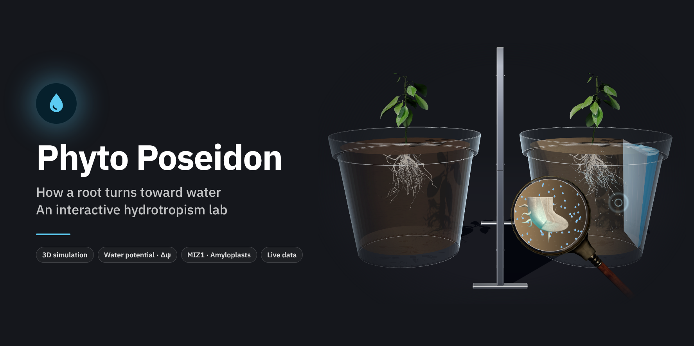
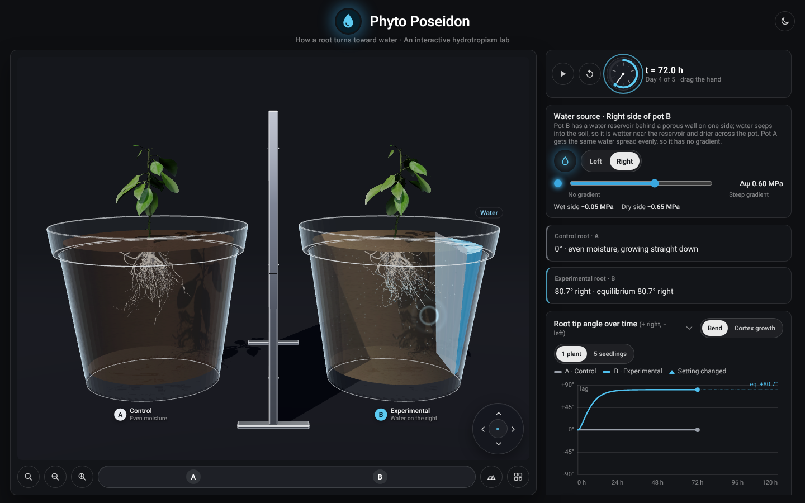
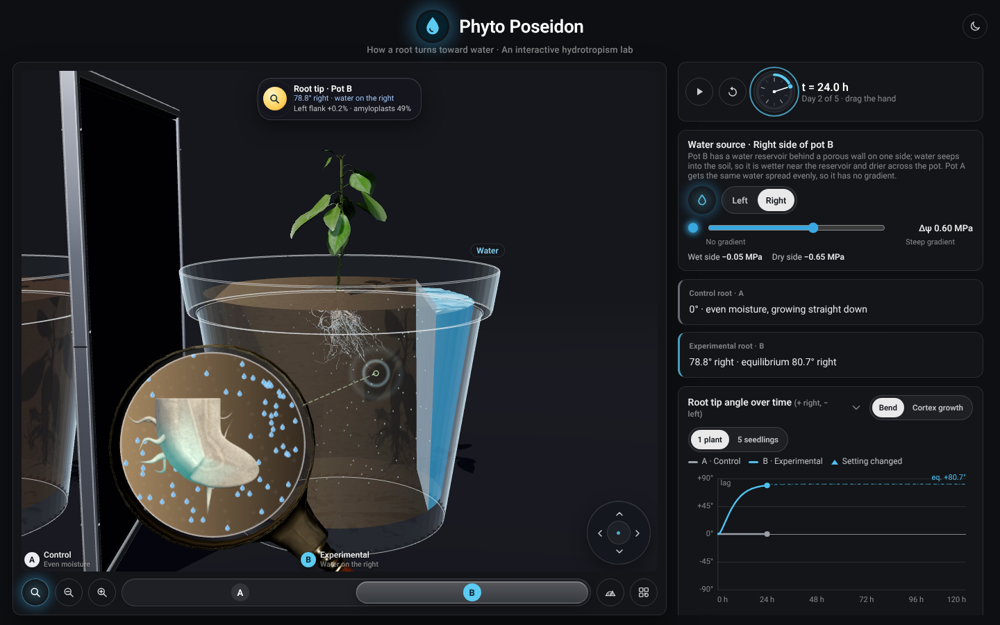
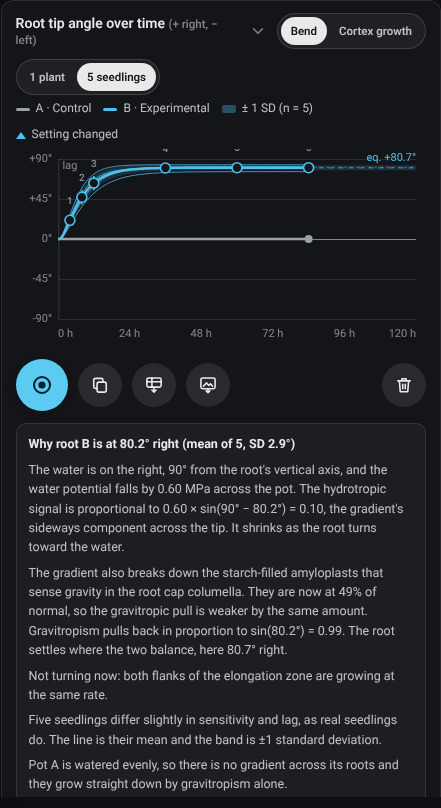
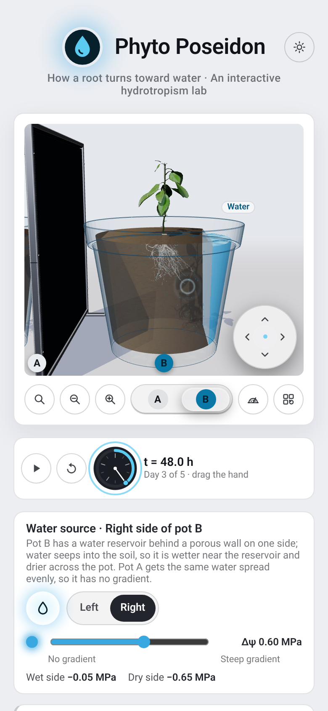

  

<h1 align="center">Phyto Poseidon</h1>

<i>How a root turns toward water · An interactive hydrotropism lab</i>

<b><a href="https://phyto-poseidon.dray-ashcroft.workers.dev/">Launch the Simulator</a></b>

  <a href="#about">About</a> ·
  <a href="#screenshots">Screenshots</a> ·
  <a href="#features">Features</a> ·
  <a href="#controls">Controls</a> ·
  <a href="#science">Science</a> ·
  <a href="#technology">Technology</a> ·
  <a href="#credits">Credits</a> ·
  <a href="#releases">Releases</a> ·
  <a href="#license">License</a>

---

## About

Phyto Poseidon is a 3D hydrotropism lab for the classroom. Two seedlings grow in clear glass pots on either side of a partition: pot A is watered evenly (the control), and pot B has a water reservoir on one side (the experimental pot). Over a simulated 5 days, the roots in pot B turn toward the water while the roots in pot A grow straight down.

The bend is calculated, not animated. The model links the moisture gradient across the root tip, differential growth of the cortex, and gravitropic straightening, which weakens as the gradient breaks down the amyloplasts in the root cap. A magnifier shows the root tip bending, a live chart and readings table record each run, and CSV export turns it into data that students can analyse.

## Screenshots

<table>
  <tr>
    <td width="50%"> <b>1 · Split-screen lab</b></td>
    <td width="50%"> <b>2 · Root tip under the magnifier</b></td>
  </tr>
  <tr>
    <td width="50%"> <b>3 · Data, readings and reasoning</b></td>
    <td width="50%"> <b>4 · Mobile, light theme</b></td>
  </tr>
</table>

## Features

| Feature | What You See | Tap to Explore |
|---|---|---|
| Two pots | Control (A) and experimental (B) seedlings in clear glass pots with see-through soil | A / B switch flies the camera to each pot |
| Water source | Reservoir behind a porous wall; droplets seep from the wet side to the dry side | Water on/off, Left / Right, gradient slider (Δψ 0 to 1 MPa) |
| Homing signal | Light pulses run up root B and rings ping from its tip while water flows | Turn the water on and play |
| Magnifier | Root tip model bending in the elongation zone; drier cortex glows teal (MIZ1 / SnRK2.2) | Magnifier button, drag the lens over a root tip |
| Measurement | Protractor below the root crown; live tip angle | Protractor button |
| Data | Root tip angle or cortex growth; 1 plant or 5 seedlings with ±1 SD | Record, copy CSV, save CSV or chart PNG |
| Reasoning | A live explanation of why root B sits at its current angle | Read under the chart |

**Concepts:** Positive hydrotropism · Water potential (ψ) gradient · MIZ1 and SnRK2.2 in the elongation-zone cortex · Cytokinin asymmetry · Amyloplast degradation in the columella · Lag phase · Differential cortex growth · Gravitropic sine law · Hydro-gravitropic equilibrium · Controlled variables · Replicates and standard deviation

## Controls

| Control | Function |
|---|---|
| Play / Pause, clock | Run 120 h in 60 s, or drag the clock hand to any hour |
| Water panel | Water on/off, reservoir side, gradient strength (dims to "Applies to pot B" in room A) |
| A / B switch | Focus the camera on pot A or pot B |
| Navigation pad, arrow keys | Orbit the camera; drag or pinch the scene to rotate and zoom |
| Reset layout | Return the camera and magnifier to the starting view |
| Reset | Restart the simulation at 0 h |
| Theme | Switch between the dark and light themes |

## Science

<b>Model and sources</b>

| Part | How it is modelled | Source |
|---|---|---|
| Sensing | Root tip senses the ψ difference across its flanks; cortex of the elongation zone responds | Dietrich et al., Nature Plants 2017 |
| Lag | Curvature starts within about 30 min of a gradient | Takahashi et al., Plant Physiology 2003 |
| Gradient | Response grows with Δψ up to 1 MPa; about 79° by 24 h at 0.6 MPa, 88° at 1.0 MPa | Takahashi et al., Planta 2002 (80–100° in 24 h) |
| Gravity | Amyloplasts fall below 60% in 30 min and to about 15% by 4 h; gravitropic pull weakens to match | Takahashi et al., Plant Physiology 2003 |
| Bend | dθ/dt = Kh·s − Kg·A·sin θ, with signal s built from G·sin(φ − θ) | Bastien, Douady & Moulia 2015 (same form as Phyto Helios) |
| Growth | Each flank differs from the mean rate by ±ω·d/2v (d = 120 µm, v = 0.2 mm h⁻¹); about ±4% at peak | Kinematics of a bending cylinder |
| Cytokinin | Builds up on the drier side of the root tip | Chang et al., 2019 |

The 120 h timeline compresses root growth for display. Amyloplast regrowth time, root system size and the response constants are illustrative.

## Technology

HTML · CSS · JavaScript (ES modules) · three.js r160 · WebGL · glTF · Canvas 2D · IBM Plex Sans · Roboto · Cloudflare

<b>Project files</b>

| File | Contents |
|---|---|
| `index.html` | Page structure, import map for three.js |
| `css/style.css` | Layout (split screen on laptops, tablets and smart panels), dark and light themes, components |
| `js/app.js` | 3D scene, hydrotropism model, water reservoir, magnifier, chart, readings, export |
| `assets/models/` | Optimised glTF models: plant, roots, pot, water, magnifier, root tip |
| `assets/screenshots/` | README screenshots |

Serve the folder over HTTP (for example Cloudflare, GitHub Pages or `python -m http.server`). Opening `index.html` directly from disk blocks the module scripts and models.

## Credits

| Contributor | Role |
|---|---|
| Aditya Sai Prasad, M.Sc. Agri. Entomology, ASRB NET | Project Designer |
| Anthropic: Claude Opus 5.5 | Code Architecture |
| OpenAI: GPT Astra 6 | Debugging, Scientific Reasoning |
| DeepSeek AI: R1 | Debugging |

<b>3D models</b>

| Asset | Model | Creator | Licence |
|---|---|---|---|
| Plant | [Avocady](https://skfb.ly/oY7EL) | Wenschel | CC BY 4.0 |
| Roots | [3D Corn root X Rat CT scan at resolution 113um](https://sketchfab.com/3d-models/3d-corn-root-x-rat-ct-scan-at-resolution-113um-045eb96fb8fc4fb688ffd19709ab9b75) | nate.ellis8 | CC BY 4.0 |
| Pot | [pot](https://skfb.ly/6Txsn) | vivikeram | CC BY 4.0 |
| Water | [Water Animation](https://skfb.ly/6WSTs) | Artise1 | CC BY 4.0 |
| Magnifier | [Styled Magnifying Glass](https://skfb.ly/oyYpS) | Incg5764 | CC BY 4.0 |
| Root tip | [Root Structure](https://sketchfab.com/3d-models/root-structure-c294d45510664ae790fba5767d03d9d2) | arloopa | CC BY 4.0 |

All models were optimised for the web (geometry simplified, textures resized or removed). The avocado's pot and soil were removed. The root scan was smoothed, recoloured and is bent at runtime. The pot is rendered as outlined clear glass. The water animation's texture was replaced by a water material. The root tip lost its baked text labels, was recoloured cream and is bent at runtime. Licence: [CC BY 4.0](http://creativecommons.org/licenses/by/4.0/).

<b>Libraries and fonts</b>

| Component | Licence |
|---|---|
| three.js r160 (GLTFLoader, OrbitControls, RoundedBoxGeometry, RoomEnvironment) | MIT |
| IBM Plex Sans | SIL Open Font License 1.1 |
| Roboto | SIL Open Font License 1.1 |

## Releases

| Release | Title | Date |
|---|---|---|
| RC I | Riverine | 27 Nov 2026 |

## License

Source code is released under the [GNU General Public License v3.0](LICENSE). 3D models remain under their creators' licences listed above.

<a href="https://github.com/Dray-Ashcroft/Phyto-Poseidon">GitHub</a> · Hosted on Cloudflare

